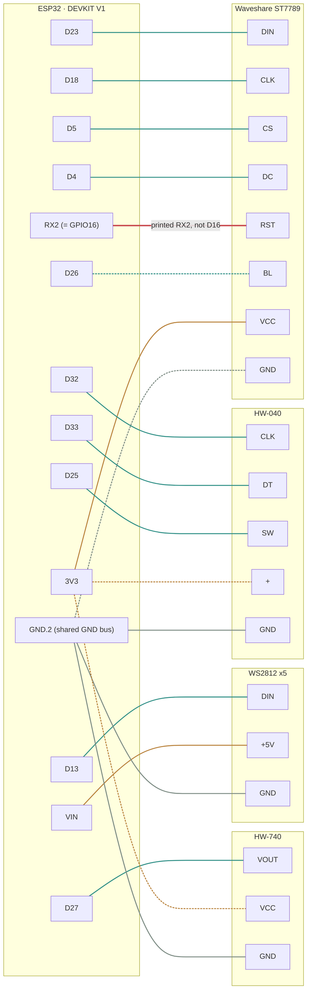

# Desk Dashboard — ESP32 client

## Role in the system
This is the "client" in a server/client relationship with a homelab-side
adapter microservice (separate repo). The ESP32 is intentionally dumb — it
subscribes to MQTT, parses whatever JSON the server publishes, and renders
it. No business logic (severity decisions, adapter polling) belongs here.

## Hardware
- MCU: ESP32-WROOM-32 dev board (ELEGOO), USB-C
- Display: Waveshare 2" IPS LCD, ST7789VW driver, 240x320, SPI (use
  TFT_eSPI library; needs a `User_Setup.h` matching actual wiring pins).
  Native orientation is portrait 240x320 — rotate to landscape 320x240 in
  software via TFT_eSPI's rotation setting.
- Input: HW-040 rotary encoder module (silkscreened HW-040, not KY-040 —
  same pinout: `CLK`, `DT`, `SW`, `+`, `GND`) — rotation for navigation,
  integrated push button for select/menu-open. Board has no visible
  pull-up resistors, so firmware always sets `INPUT_PULLUP` on all three
  signal pins — safe even if pull-ups turn out to be present too.
- Status LEDs: 5x WS2812 (NeoPixel) addressable strip, 5050 flexible strip
  with each pixel's pads labeled `+5V`/`DIN`(or `DO`)/`GND` and an arrow
  showing data direction into `DIN`. Use FastLED or Adafruit_NeoPixel.
  Wire the ESP32 to the end labeled `DIN`. Add a series resistor (~300-500
  ohm) on the data line and a decoupling cap (~100-1000uF) across 5V/GND,
  both at that `DIN` input end. Data line is 3.3V (ESP32 GPIO) driving
  5V-logic pixels — works fine at this scale over short wire runs; revisit
  with a level shifter (74AHCT125) only if signal issues appear.
- Presence: HW-740 mini PIR motion sensor module (`VCC`/`VOUT`/`GND`) —
  drives backlight on/off based on whether anyone's at the desk. Powered
  from 3.3V, not 5V/6V (within its spec range but the safer choice): the
  digital output swings up to VCC, and running it at 3.3V keeps that
  signal within the ESP32 GPIO's safe voltage range instead of risking a
  5V signal into a 3.3V-only input.
- Power: External 5V/2A DC supply (USB-C wall adapter) — no battery/UPS.
  Desk-bound and always-on, so battery backup isn't solving a real problem
  here; deferred to a future project instead. 2A over 1A for headroom: WS2812
  strip at full white (~300mA) plus a WiFi TX burst (~500mA momentary) plus
  display/backlight leaves a 1A supply almost no margin, risking brownout
  resets. Bring 5V/GND from the adapter to a shared point and branch to (a)
  the ESP32's `5V`/`VIN` pin (or USB-C port) and (b) the LED strip's 5V/GND
  input directly — don't route strip current through the ESP32's onboard
  3.3V regulator.

  Powering the board via its USB-C port instead of wiring 5V into `VIN`
  directly doesn't change any of this: `VIN` and USB-C's 5V input are the
  same net on this board (confirmed against ESP32 DevKit V1 hardware
  references, not assumed) — plugging in USB-C energizes `VIN` too, so
  branching the LED strip's power off the board's own `VIN`/`GND` pins
  works exactly as already wired. Only watch for it if the board resets
  specifically when the LEDs go bright — that would mean the strip's
  ~300mA is more than the board's internal USB-5V-to-`VIN` trace likes,
  and the fix is running the strip's `+5V`/`GND` straight to the adapter
  instead of through the board.

## Pin assignments
Verified against the actual ELEGOO ESP32-WROOM-32 board (38-pin
"DEVKIT V1" layout), the Waveshare display module, the HW-040 encoder, and
the WS2812 strip in hand — not just datasheets. Board is WROOM (no PSRAM),
so GPIO16/17 are free to use as plain GPIO.

See [`docs/pinout.html`](docs/pinout.html) for a visual wiring diagram —
open it in a browser (it's self-contained, no server needed). Same data
as the table below, laid out for the workbench: shows the two GPIO16 and
PIR pinout gotchas directly on the wires that matter, and draws the 3V3
power-bus crossing explained in the Power note above.

A lighter version of the same wiring, for whenever opening that HTML
file isn't convenient — this one renders directly on GitHub:



Both power and ground are physical bus strips in the real build, not
point-to-point wiring — see the "bus strips" note below. Dashed
edges are every wire that has to cross to reach one: backlight to the
left column, 3V3 fanning out to the right, and the display's ground
crossing left too (GND is sourced from `GND.2`, not `GND.1`, since
three of the four things needing it already sit on that side). The red
edge is the RX2 gotcha. Same underlying data as the table below and
`docs/pinout.html` — if these three ever disagree, the table is the
source of truth to reconcile the other two against.

| Function | Signal | GPIO | MCU board silkscreen |
|---|---|---|---|
| Display | MOSI/`DIN` | 23 | `D23` |
| Display | SCLK/`CLK` | 18 | `D18` |
| Display | `CS` | 5 | `D5` |
| Display | `DC` | 4 | `D4` |
| Display | `RST` | 16 | **`RX2`** — not `D16`, see note |
| Display | `BL` | 26 | `D26` — digital on/off, not PWM (see note) |
| Display | `VCC`/`GND` | — | 3.3V / GND |
| Encoder | `CLK` | 32 | `D32` |
| Encoder | `DT` | 33 | `D33` |
| Encoder | `SW` | 25 | `D25` |
| Encoder | `+`/`GND` | — | 3.3V / GND |
| LED strip | `DIN` | 13 | `D13` |
| LED strip | `+5V`/`GND` | — | from the external 5V supply, not the ESP32 |
| PIR | `VOUT` | 27 | `D27` |
| PIR | `VCC`/`GND` | — | 3.3V / GND (3.3V, not 5V — see Hardware note) |

Notes:
- **GPIO16/17 silkscreen gotcha:** this specific board prints its alternate
  UART2 function (`RX2`/`TX2`) on GPIO16/17 instead of `D16`/`D17`. Display
  `RST` is wired to `RX2`. Don't go looking for a pin labeled `D16` — it
  isn't there under that name.
- Display board has no `MISO`/`SDO` pin at all (write-only) — leave
  `TFT_MISO` undefined in `User_Setup.h` rather than pointing it at an
  unused GPIO.
- `BL` is digital on/off (`digitalWrite`), not PWM dimming — the PIR-driven
  backlight behavior (see Firmware architecture) only needs two states,
  so there's no need for LEDC/PWM complexity here.
- **Both 3V3 and GND are physical bus strips, not point-to-point wiring:**
  a row of header pins with their legs bridged by a soldered wire across
  the back, one feed-in and several feed-out per strip. 3V3 has no
  choice (it's the only 3.3V pin on the board), but GND is a deliberate
  choice too — sourced from `GND.2` specifically (not `GND.1`) since
  three of the four things needing ground (encoder, PIR, LED strip)
  already sit on that side, so only the display's ground needs to cross,
  rather than adding more crossings. `GND.1` is unused as a result —
  it's a hardwired ground pin on the board, not a GPIO, so it doesn't
  belong in the "free for later" list below the way an unused GPIO would.
- Not used, confirmed present and free for later: `D14`, `D19`, `D21`,
  `D22` (the latter two freed up when the UPS/I2C module was dropped;
  `D26`/`D27` are now taken by backlight control and the PIR).
- Still avoid: `GPIO0`/`2`/`12`/`15` (boot straps), `GPIO1`/`3` (UART0 —
  flashing/Serial), `GPIO6`-`11` (internal flash), `GPIO34`-`39`
  (input-only, no internal pull-up — ruled out the encoder pins for that
  reason, since the HW-040 board supplies none of its own).

## Firmware architecture
### Connectivity
- WiFi connect with reconnect logic (don't assume it stays up)
- MQTT client (PubSubClient or ArduinoMqttClient) subscribing to:
  - `homelab/status` — full status payload; update relevant UI on receipt
  - `homelab/alert/camera` — jump to camera pop-up view on receipt
- MQTT reconnect logic is a real piece of work here, not an afterthought —
  handle broker disconnects gracefully, don't just hang

### Screen state machine
Three states, not more:
1. **HOME** (default) — top banner (~30px) shows alert status
   (green/amber/red + short text); body auto-rotates through status
   cards; bottom shows position dots. Manual encoder rotation pauses
   auto-rotate for ~10s then resumes. Per-card display time is a
   Configs-menu minimum (`cardRotationSeconds_`, 5s default), not a
   fixed interval — extended, if needed, until every scrolling detail
   line on that card has completed one full marquee pass, so a card
   with long text never gets cut away mid-scroll (`computeCardDisplayMs()`
   in `screen.cpp`).
2. **MENU** — opened by encoder button press from HOME. Full-screen
   overlay, vertical list, 6 visible rows (grew from an original 5 when
   Configs was added — see Backlight/presence below), current selection
   highlighted (inverted color). Items: Actions, Pin a screen, Mute
   alerts, Refresh now, Network info, Configs, Back (7 rows at 32px since
   Actions was added). 15-20s idle timeout returns to HOME — held off
   while an action is in flight or showing its result.
3. **CAMERA** — auto-triggered by an incoming `homelab/alert/camera`
   message (not reachable from the MENU item list above, and nothing in
   that list is camera-related). Suppressed entirely while muted, same
   "don't surprise-interrupt" principle as the backlight. Decodes a JPEG
   snapshot (TJpg_Decoder) proxied from the server — NOT live video,
   ESP32 cannot decode RTSP/H.264. This is a distinct screen state, not
   blended into HOME's auto-rotation, since JPEG decode + SPI blit is
   slow enough to disrupt the main loop if run continuously. Exits back
   to HOME on either an encoder button press or the same shared idle
   timeout as MENU — this needed its own exit condition, since there was
   otherwise no way to leave it once an alert had no viewer around to
   dismiss it. The fetch/decode itself runs from `loop()`, not the MQTT
   callback — see "Camera snapshot fetch" below.

### Actions (MENU > Actions)
Added 2026-09-26 with the server's Home Assistant adapter (see the
server repo's DESIGN.md "Actions" for the full design and why it goes
through the server rather than Home Assistant directly). This device
stays as dumb as ever: it lists `actions[]` from the status payload,
and a press publishes that row's `id` to `homelab/action`. It never
knows what an action does and holds no Home Assistant credential.

- Rotate to pick; the list scrolls 6 rows at a time ("more ^"/"more v"
  hints), with a trailing Back row. No actions → a "set them up on the
  server" note; press goes back.
- Right side of a row, first match wins: `Sending...` (this row's request
  in flight), the reply's `text` for 2.5s (green if ok, red if not),
  `Press again` (a `confirm` row armed by its first press, for 3s —
  rotating cancels it), else the server's `state`.
- One request at a time. No reply within 5s shows `No reply`; not
  connected to the broker shows `Offline` straight away.
- A new status message redraws the list (fresh `state`s), keeps the
  selection in range, and disarms any `confirm` press — the row under the
  cursor may now be a different action.
- screen.cpp owns the menu but not MQTT: main.cpp hands it a sender
  (`screenSetActionSender`) and forwards replies
  (`screenOnActionResult`, which only records — drawing stays in loop()).
- **Broker ACL:** the `esp32-client` account needs write access to
  `homelab/action` and read access to `homelab/action/result` (the
  server repo's `mosquitto/config/acl.conf`). Without them the request is
  dropped silently and the row shows `No reply`.

### Backlight / presence
Independent of screen state — runs the same in HOME, MENU, and CAMERA.
PIR `VOUT` HIGH turns the backlight (`BL` GPIO) on immediately, and so
does any encoder input (rotation or a press) — whichever happened more
recently is what keeps it lit. That second trigger was added after
real-world use turned up a real gap: PIR-only meant actively using the
menu with a hand on the encoder, but not otherwise moving enough to
retrigger the PIR, could dim the screen out from under you mid-
interaction. On no activity from either source for the timeout window,
it switches off. No PWM/dimming — just on/off, since that's all this
needs. Doesn't touch screen state at all: CAMERA and MENU behave exactly
as already designed regardless of presence; this only ever changes
whether the backlight is lit.

The timeout itself is no longer DESIGN.md's shared `kIdleTimeoutMs`
(still used by MENU/CAMERA) — it split into its own value in
`backlight.cpp`, runtime-adjustable via the MENU's **Configs** item
(rotate to change in 5s steps, clamped 5-120s, press to save). Unlike
mute/pin, this *does* persist across a reboot (see `settings_store.h`)
— it has no safety angle either way, so there's no reason to make the
user re-dial it in after every restart. Falls back to its compiled-in
default (18s) on first boot or after a full chip erase.

### Non-blocking is mandatory
No `delay()` calls anywhere in the main loop — use `millis()`-based timers
for card rotation, menu timeout, etc. Blocking delay breaks encoder
responsiveness and MQTT message handling.

### Pixel mapping
The server sends a pixel-index -> color mapping as the `pixels` object in
`homelab/status` — e.g. `{"0": "#1D9E75", "1": "#BA7517", ...}`, keys `"0"`
through `"4"`, value `null` for an unassigned pixel. The firmware just sets
those pixel colors directly (or turns the pixel off on `null`); it does not
decide which service maps to which pixel or which color a status implies —
that's all server-side (see `pixel_map` config in the server repo).

### Card templates
A HOME card's "template" is nothing more than how many lines it has —
there's no separate template concept anywhere in the firmware needing to
stay in sync with anything else. Each service becomes `1 + detailLineCount`
total lines (name/title, colored by `status`; then 0-4 detail lines, white),
each one vertically filling its equal share of the card and scrolling
horizontally (a two-copy marquee, clipped to its own line) if it doesn't
fit the screen width. `screen.cpp` never special-cases a service by name —
it just renders however many lines the current card's `ServiceReading`
carries.

The content of those detail lines is the server's call entirely, via the
schema's `lines` field (see below) — an adapter with one interesting fact
sends one line and gets a simple card; one with several (like
`uptime_kuma`) sends more and gets a richer one. The client makes zero
decisions about what's worth showing, matching the "intentionally dumb"
principle elsewhere in this doc.

Per-line character capacity (`kDetailLineLens` in `status_payload.h`) is
asymmetric, not a single shared constant: 25 / 75 / 75 / 225 for lines
1-4. Line 4 carries content that regularly runs long; a uniform cap sized
for that would cost every line that space whether it used it or not
(900 bytes/service vs. this table's 400). The asymmetry is contained to
one place — `ServiceReading::detailLine(i)` — so parsing and rendering
code still just loops `0..detailLineCount` without knowing the lengths
differ. One consequence worth knowing: the legacy no-`lines` fallback
(folding `value`/`unit`/`detail` into a single line, for an adapter that
hasn't sent `lines` yet) always writes into line 1's 25-char slot now,
down from the old uniform 100 — a `detail` string longer than 25 chars
truncates harder than it used to on that fallback path specifically.

`lines` was added to the locked schema specifically to support this —
proposed from this repo, implemented and confirmed live by the server
repo the same day. Originally optional (adapters opted in); the server
repo has since made it required and always-populated for every service,
folding `value`/`unit`/`detail` server-side for any adapter that doesn't
build custom content, the same way ours does client-side. The client's
own fallback for a missing `lines` is dead code in practice now, but
kept as defensive robustness against a future adapter regression rather
than removed.

### Camera snapshot fetch
`screenOnCameraAlert()` (called synchronously from the MQTT callback)
only ever records the alert into `cameraAlert_` and flips a
pending-fetch flag — it never touches the network or does SPI/TFT work.
The actual `snapshotUrl` fetch and JPEG decode happen from
`screenCameraFetchIfPending()`, called every `loop()` iteration but a
cheap no-op unless a fetch is actually pending. This mirrors the
`gLatestStatus`/`gHasNewStatus` pattern in `main.cpp`, and exists for
the same reason as Bug 1 below: an HTTP fetch (bounded to ~5s worst
case) run synchronously inside the MQTT callback would block
`mqttClient.loop()` far longer than the microseconds-long
`FastLED.show()` call that originally triggered the message-repeat bug
— a much bigger risk for the exact same failure mode, not a smaller one.

The fetch itself (`src/screen.cpp`'s `httpGetToBuffer()`) is a plain
blocking call bounded by an explicit `millis()` deadline — no async
state machine. Camera alerts are one-shot and infrequent (60s
per-camera cooldown, server-side), so a single bounded blocking gap of
up to ~5s in `mqttClient.loop()` servicing is an acceptable, documented
tradeoff, not something worth an async rewrite for. A second alert
arriving while the CAMERA screen is already showing overwrites
`cameraAlert_` and re-arms the pending-fetch flag cleanly, same as
`gLatestStatus` handles a second `homelab/status` message arriving
before the first was consumed.

It deliberately does **not** use ESP32's `HTTPClient` class.
`HTTPClient.h` unconditionally pulls in `WiFiClientSecure` (full
mbedTLS plus the root cert bundle) whether or not it's ever used for
`https://` — measured at ~45KB of flash here, more than this board had
room for (see the partition note below), for TLS support this fetch
will never need: the snapshot endpoint is plain HTTP, no auth, per the
server contract. `httpGetToBuffer()` is a small hand-rolled HTTP/1.1
GET instead — parses a status line and a `Content-Length` header, then
reads exactly that many body bytes; no chunked encoding, no redirects,
nothing the snapshot endpoint doesn't use.

The received JPEG lands in a heap-allocated ~64KB buffer
(`fetchAndDecodeSnapshot()`, sized for "typical ~13KB, worst case seen
~45KB" per the server side), `malloc()`'d fresh per alert and `free()`'d
right after decode — a scoped allocation, not a function-static one.
That was the first design (matching the `static JsonDocument` pattern
in `status_payload.cpp`, avoiding malloc/free churn), but a static 64KB
buffer doesn't fit in this board's actual DRAM (320KB total, confirmed
by the linker: `pio run` failed with "DRAM segment ... overflowed") on
top of everything else already static. A scoped allocation is fine here
specifically because camera alerts are rare and one-shot, nothing like
the every-15-60s `homelab/status` cadence that made per-message String/
JsonDocument churn a real problem in Bug 2 below. Before allocating,
`fetchAndDecodeSnapshot()` checks `ESP.getFreeHeap()` against a
conservative floor and skips the fetch (falling back to "Snapshot
unavailable") if free heap is already unusually low, rather than
risking an allocation failure mid-decode.

TJpg_Decoder streams decoded tiles straight to `tft.pushImage()` as
they come off the decoder (`cameraTileOutput()`, its render callback),
so there's never a second full-frame pixel buffer in RAM alongside the
JPEG receive buffer.

**Flash headroom, and a partition table change this feature required:**
this board's default OTA partition table (`default.csv` — two 1.31MB
`ota_0`/`ota_1` app slots) was already at 99.7% flash usage *before*
this feature (confirmed by building the prior commit standalone), and
TJpg_Decoder plus its own fetch/decode code needs about 10.5KB more
than the ~4.5KB of slack that left — not something reducible further
without cutting existing, working functionality (TJpg_Decoder's own
code is already near its practical floor; see the `HTTPClient`
avoidance above for the one place real savings existed).
`platformio.ini` now sets `board_build.partitions = min_spiffs.csv`,
which keeps the same dual ota_0/ota_1 layout ArduinoOTA needs but grows
each app slot to 1.9MB by shrinking the spiffs partition (128KB) down
to its minimum. That partition sat completely unused until the status
icon font below started using it — see "Status icon font" for what
now lives there and how much room is left. **This is a partition table change, not
just a bigger binary** — the table itself lives at a fixed flash offset
(0x8000) and is only written by a full USB flash, never by an OTA
update (`espota` only writes into whichever app slot the
already-burned table defines). Confirmed on real hardware: an OTA
upload built against the new table was safely rejected by a device
still running the old one (`Update::begin()` checks the requested size
against the *actual* on-device partition before writing anything — see
`Updater.cpp` — so this fails clean, doesn't corrupt anything, and
the device keeps running its current firmware) but also doesn't update
it. A device on the old table needs one USB-connected flash with this
partition scheme before OTA uploads against it will succeed again;
every OTA after that one-time reflash works exactly as before.

### Status icon font
The built-in TFT_eSPI fonts (`include/User_Setup.h`) are monochrome
ASCII/Latin bitmap sets with no symbol glyphs — there's no way to render
a checkmark, wifi, or battery glyph with them. `data/icons.vlw` is a
custom TFT_eSPI "smooth font" (an anti-aliased bitmap font format, not a
vector one) built from a curated subset of Material Design Icons, loaded
from the SPIFFS partition described above rather than compiled into the
app binary — so it competes with the SPIFFS budget, not the already-tight
app-partition flash. `include/icons.h` holds the matching `Icon::k*`
codepoint constants, plus a generated `Icon::lookupByName`/
`Icon::advanceForCodepoint` pair used to expand a server-sent `:name:`
code into its glyph — see the server repo's DESIGN.md "Card icons" for
the wire format and the full worked example, and `status_payload.cpp`'s
`copyTruncatedWithIcons`/`screen.cpp`'s `splitLineRuns` for how a line
gets split into text/icon runs and drawn.

TFT_eSPI only keeps one smooth font's glyph metrics in RAM at a time, so
it can't stay loaded alongside the UI's normal bitmap fonts (2/4) —
`drawIcon()` (the single standalone status glyph) loads, draws, and
unloads per call; `drawCardLine()` (a detail row's inline icons) batches
every icon in the row under one load/unload pair instead of one per
icon, since a scrolling row redraws every 120ms and reloading per glyph
there would be a real, measurable cost.

Regenerate both files together with `tools/icons/build_icons.py` — see
that script's header comment for setup. At the current 146-icon set,
24x24px each (matching Font 4's ~26px line height, which every card row
renders in — an earlier 16px pass looked small once actually next to
Font 4's numerals on real hardware), the font is ~53.7KB (~42% of the
128KB partition). Two things worth knowing before adding more icons:

- **MDI's own codepoints don't survive the round trip.** MDI's real
  codepoints (e.g. `wifi` = U+F05A9) sit in the Unicode supplementary
  plane, but TFT_eSPI's smooth-font loader stores each glyph's codepoint
  as a 16-bit value and its UTF-8 decoder explicitly refuses 4-byte
  sequences (`Smooth_font.cpp`'s `loadMetrics`, `TFT_eSPI.cpp`'s
  `decodeUTF8`). The build script renders the real MDI glyph artwork but
  remaps every icon to its own codepoint starting at U+E000 (the Basic
  Multilingual Plane's Private Use Area) — `icon_list.txt`'s order is
  what determines each icon's assigned codepoint, so re-ordering that
  file changes codepoints too (harmless as long as `icons.h` is
  regenerated in the same step, which it always is — but see the server
  repo's own icon_catalog.json/icon-paths.ts, which only carry names, not
  codepoints, precisely so they never need to agree on numbering).
- **The 128KB partition still has real headroom left** (~42% used at
  146 icons), so there's room for a larger set if a future feature needs
  it — at 24px each icon costs ~377 bytes on average (VLW only stores
  each glyph's ink bounding box, not a fixed cell, so simple icons cost
  less than dense ones), meaning roughly 28 more icons would still fit
  before crossing half the partition, or another ~200 before filling it
  outright.
- **Changing `icon_list.txt` needs BOTH `uploadfs` AND a real firmware
  `upload`, not just the first one.** `data/icons.vlw` (glyph bitmaps)
  goes to SPIFFS via `uploadfs` — but `Icon::kTable`, the name→codepoint
  lookup `copyTruncatedWithIcons` uses to recognize a `:name:` code at
  all, is generated into `icons.h` and compiled straight into the
  firmware binary. Confirmed the hard way: after adding icons with only
  an `uploadfs` (reasoning that `screen.cpp`/`status_payload.cpp` hadn't
  changed, which was true — `icons.h`'s *generated content* had, which
  matters just as much since it's `#include`d into those same files),
  the device kept running its old firmware's stale, smaller table.
  Every new `:name:` code fell through `Icon::lookupByName` as
  "unknown" and printed as literal text (`:account:` right there on the
  screen) instead of drawing anything — no error, no crash, just a
  wrong-looking card until the actual firmware got reflashed too.

## MQTT JSON payload schema
Locked against the server repo (`desk-dashboard-server/DESIGN.md`) — both
docs carry this section verbatim; update them together if it changes.

### `homelab/status`
Published on any adapter state change and as a ~30-60s heartbeat regardless.
```json
{
  "version": 1,
  "ts": 1737000000,
  "overall": {
    "level": "ok",
    "text": "All systems normal"
  },
  "services": [
    {
      "name": "plex",
      "title": "plex",
      "status": "ok",
      "value": 4,
      "unit": "streams",
      "detail": "4 active streams",
      "lines": ["4 active streams"]
    },
    {
      "name": "uptime_kuma",
      "title": "Uptime Kuma",
      "status": "ok",
      "value": 71,
      "unit": "/71 up",
      "detail": null,
      "lines": [
        "71 / 71 monitors up",
        "All monitors healthy",
        "24h uptime avg: 100.0%"
      ]
    }
  ],
  "pixels": {
    "0": "#1D9E75",
    "1": "#BA7517",
    "2": "#1D9E75",
    "3": "#1D9E75",
    "4": null
  },
  "actions": [
    {"id": "desk_lamp", "label": "Desk lamp", "state": "on", "confirm": false},
    {"id": "garage", "label": "Garage door", "state": "closed", "confirm": true}
  ]
}
```
- `overall.level` is `"ok"` | `"warn"` | `"down"` — drives the HOME banner
  color directly; the client does not derive it from `services`.
- `overall.text` is the short banner string, already worded server-side.
- `services` is an array, in server-decided order — that order is the HOME
  card rotation order. Each entry matches the adapter's `fetch()` shape
  (`status`/`value`/`unit`/`detail`) from the server repo.
- `title` (added after the initial lock, same pattern as `lines` below)
  is required and always populated — falls back to `name` server-side
  for any adapter that hasn't set a custom one. `name` stays the stable
  identifier and is never itself shown; the client renders `title` on
  the card's title line. The two diverge already (e.g. AdGuard's
  `name` is `adguard_main`), which is exactly why this exists instead
  of just showing `name`.
- `lines` (1-4 strings, added after the initial lock — see "Card
  templates" below) is required and always populated for every service
  — originally optional, tightened server-side after adoption. The
  client shows these lines verbatim; it still has a fallback that folds
  `value`/`unit`/`detail` into one line if `lines` is ever missing, but
  that path shouldn't fire against a real message anymore. Each string
  is pre-formatted exactly as the server wants it shown — the client
  does zero formatting logic on them, same as everything else here.
- `pixels` keys are always strings `"0"`-`"4"` (JSON object keys can't be
  bare ints); `null` means "off/unassigned", not "no change".
- `actions` (added 2026-09-26) is the MENU > Actions list, in order — see
  "Actions" below. `state` is short live text drawn right-aligned on the
  row (`null` = nothing); `confirm` means the row needs a second press.
  Sized to the server's own limits (12 entries, 23-byte id/label, 11-byte
  state), so nothing is truncated here. Absent = no actions.
- `ts` is unix seconds. Not currently used by the firmware but parse it
  anyway — useful for staleness checks later (e.g. banner goes gray if no
  message for N minutes).

### `homelab/alert/camera`
```json
{
  "camera": "driveway",
  "ts": 1789865193.6,
  "snapshot_url": "http://192.0.2.20:8031/snapshot/driveway?event=1789854130.091129-f9r0uf",
  "label": "person",
  "text": "Driveway: person detected"
}
```
- `snapshot_url` is fetched by the ESP32 over plain HTTP GET (not embedded
  in the MQTT payload — keeps the message small and avoids broker
  max-packet-size issues). It's a baseline (non-progressive) JPEG, about
  90 characters, comfortably inside `kUrlLen`. The server scales the
  camera frame to fit the display's resolution while preserving aspect
  ratio, letterboxing on black — not a hard resize/stretch, so a 16:9
  source doesn't come out distorted.
- The display's resolution the server targets is landscape (320x240,
  `SNAPSHOT_WIDTH`/`SNAPSHOT_HEIGHT` server-side) to match this device's
  UI, which is landscape everywhere else (see "Screen state machine"
  above) — coordinated with the server repo when the CAMERA screen was
  built; not the server's original default (portrait 240x320).
- `label` is the detected object class, optional — omit or `null` if not
  applicable.
- `text` is the pre-worded string for the CAMERA screen's caption, at
  most 63 characters (`kAlertTextLen`).

### `homelab/action` (published by this device)
```json
{"id": "desk_lamp", "req": 17}
```
- The only topic this device publishes to. `id` comes straight from
  `actions[]`; `req` is a counter this device keeps, echoed in the reply.
  Built with `snprintf` (`buildActionRequest()`), no heap; an id outside
  `[a-z0-9_]` is refused rather than sent unescaped.

### `homelab/action/result` (published by the server)
```json
{"id": "desk_lamp", "req": 17, "ok": true, "text": "Done"}
```
- One reply per request. Only a reply matching the request in flight
  (same `id` and `req`) is shown; anything else is ignored.

### Firmware implication
Default `PubSubClient` payload buffer is 256 bytes — too small once
`services` has more than 1-2 entries. Call
`mqttClient.setBufferSize(...)` sized to the largest expected
`homelab/status` payload, with headroom for adapter count growing past
the initial 2-3. Done in [`src/main.cpp`](src/main.cpp) — currently 4096
bytes (was 2048 until `actions[]` added up to ~1KB to every status
message); revisit if `services` grows enough to need more. A message
bigger than the buffer is dropped whole, not truncated.

## Project layout
PlatformIO project (`platformio.ini`). `src/main.cpp` wires together one
small module per concern: `status_payload` (JSON parsing), `encoder`,
`leds`, `backlight`, `screen` (the HOME/MENU/CAMERA state machine), `ota`.
Real credentials go in `include/secrets.h` (gitignored; copy
`include/secrets.h.example` and fill it in) — never commit that file.
`data/icons.vlw` and `include/icons.h` are generated together by
`tools/icons/build_icons.py` — see "Status icon font" above. `data/`
is uploaded to the device separately from firmware, via
`pio run -t uploadfs`, not the normal `-t upload`/OTA flash step.

## OTA firmware updates
`ota.cpp` runs ArduinoOTA (built into the ESP32 Arduino core, no extra
library) once WiFi is connected — independent of MQTT, so a broken
broker/server never blocks the one way to fix broken firmware. Once it's
running, no USB/physical access is needed to flash new firmware again:

```
OTA_PASSWORD=<same value as secrets.h's OTA_PASSWORD> pio run -t upload -e esp32dev-ota
```

`upload_port` in `platformio.ini` defaults to the board's mDNS hostname
(`desk-dashboard-esp32.local`); if `.local` resolution doesn't work on
your network/OS, override it with the device's actual IP instead:
`pio run -t upload -e esp32dev-ota --upload-port <ip>` (read off Serial —
`ensureWifi()` prints it once on connect).

`OTA_PASSWORD` has to exist in two places, for two different reasons: as
a `#define` in `secrets.h` (compiled into the firmware, so it can
authenticate incoming OTA requests) and as a shell env var of the same
name (read by `platformio.ini`'s `upload_flags` at upload time, so the
*tool* doing the flashing can prove it knows the password too). Without
a password at all, anything on the LAN could push firmware to this
board — not something to skip even on a trusted home network.

Verified end-to-end on real hardware: a real OTA upload over WiFi with
no USB cable attached, board rebooted cleanly afterward, resumed normal
operation.

## Reliability: a message-repeat bug, and heap hygiene
Two unrelated bugs, found on real hardware, not in review — both would
have been invisible in a short bench test and both matter specifically
*because* this runs unattended for days at a time.

### Bug 1 — FastLED.show() inside the MQTT callback
Symptom: the exact same `homelab/status` message got redelivered to
`onMqttMessage()` thousands of times a second, indefinitely, instead of
once every 15-60s like the broker actually sends it.

Cause: `ledsUpdate()` (i.e. `FastLED.show()`, which briefly disables
interrupts for WS2812's precise bit timing) was running synchronously
inside the callback. That delayed the TCP ACK for the packet just
received long enough that the broker's stack retransmitted it; our stack
delivered the retransmission as a "new" MQTT message, which called
`ledsUpdate()` again, delaying the ACK again — self-sustaining.

Fix: moved `ledsUpdate()` out of the callback and into `loop()`, gated
by the same one-shot "a new message actually arrived" flag already
driving the screen. The callback now only ever parses and sets a flag —
no SPI, no FastLED, nothing that can block returning to the network
stack.

One methodology trap worth recording: after applying this fix, the same
symptom appeared to persist across several follow-up tests. It hadn't —
each of those tests was reading a mix of genuinely fresh serial output
plus *stale backlog from an older, already-stuck boot* still sitting in
the OS's kernel serial buffer. A clean single-reset capture, read from
that exact reset forward, was what actually confirmed the fix. Multiple
`pio device monitor`/pyserial sessions opened back-to-back without an
explicit fresh reset will misattribute old output to new firmware.

### Bug 2 — heap fragmentation from per-message String/JsonDocument churn
This one doesn't show up as a dramatic failure — it's a slow-onset risk
that a short test can't rule out, only a long one can.

Every incoming message (every 15-60s, forever, for as long as this
board is plugged in) used to: construct a fresh `JsonDocument` and
destroy it, and reassign ~26 `String` fields across
`StatusPayload`/`ServiceReading`. Both are real heap allocate/free
cycles. Individually harmless; over thousands of cycles across days of
uptime, this is exactly the kind of workload that fragments an embedded
heap (many small allocations of varying size, `String` in particular
has no reuse-in-place guarantee on reassignment).

Fix:
- `status_payload`'s `String` fields became fixed `char[]` buffers
  (silently truncated if ever too long, never a crash) — zero heap
  involvement.
- The `JsonDocument` in each parse function became a function-`static`,
  reused via `.clear()` rather than constructed fresh per call.
  Confirmed against ArduinoJson's own source (not assumed) that
  `clear()` resets the memory pool without necessarily freeing the
  backing allocation.
- The MQTT topic comparison in `main.cpp` became `strcmp`, not a
  temporary `String` — same reasoning, still per-message.
- `screen.cpp`'s `colorForLevel()` and the muted-banner text also
  stopped going through `String`, since they're on the HOME redraw path
  (frequent, if not per-message).

**Verification methodology** (this is the part a clean compile can't
give you): added temporary heap diagnostics to `main.cpp` — logged every
30s via `ESP.getFreeHeap()`, `ESP.getMinFreeHeap()`, and specifically
`ESP.getMaxAllocHeap()` (the largest *contiguous* allocatable block —
the fragmentation-sensitive number; total free heap can look fine while
this one shrinks). Watched both figures on the pre-fix firmware as a
baseline, then on the fixed firmware, deployed via OTA specifically so
the comparison didn't require another USB session.

As of this writing: pre-fix baseline held flat for 5 minutes before
switching over (not long enough to have caught the original problem
either — it's what gave the false "fixed" impression the first time).
Post-fix, `free`/`maxAlloc` held completely flat through at least the
~15 minute mark, past the point where the original symptom first
appeared. Longer soak testing (hours, ideally a full day) is the only
way to be fully confident this is resolved rather than just slower to
surface — treat that as still open.

**Cleanup note:** the heap diagnostic block in `main.cpp` (marked
`TEMPORARY` in its comment) should come out once this is confidently
resolved — it's a real, if small, ongoing Serial-print cost that has no
reason to ship permanently.

### Bug 3 — pixels render white during real operation (open, unresolved)
Symptom: `services[0]`/`services[1]`'s pixels (adguard_main,
uptime_kuma) render solid white on the physical strip, regardless of
the actual color the server sends (confirmed green, `#1D9E75`, via
both `GET /status` and the raw retained MQTT message).

Ruled out, each confirmed directly rather than assumed:
- Software: hex-parsing math verified correct with a standalone
  compiled test (`#1D9E75` → r=29 g=158 b=117, not white); no gamma/
  brightness-correction code exists anywhere; `WS2812B`+`GRB` is the
  standard/correct FastLED chipset combo for this strip.
- The GPIO pin itself: reproduces identically on GPIO14 as on the
  documented GPIO13/D13 — tested twice, including after the WiFi
  correlation below was known.
- The `DIN` pad (not `+5V`/`GND`): confirmed via a close-up photo of
  the solder joint.
- Wiring continuity, end to end, power off: verified with a multimeter
  on every wire including ground.
- Common ground between the ESP32 and the strip: guaranteed, since the
  strip's `+5V` is fed from the ESP32's own `VIN` pin, not a separate
  supply.
- `WiFi.setSleep(false)` (disabling WiFi modem-sleep, a common ESP32
  fix for CPU-timing jitter corrupting bit-banged WS2812 output): no
  effect. Consistent with checking FastLED's actual ESP32 platform
  code (v3.10.3) and confirming this board already resolves to the
  RMT-hardware-peripheral driver, not a CPU cycle-counted bit-bang loop
  — the mechanism `setSleep(false)` would fix doesn't apply here.

What's actually been observed, and what it points at:
- A boot-time test that calls `ledsUpdate()` directly with a literal
  `#FF0000` payload — before `WiFi.begin()` is ever called, bypassing
  MQTT/JSON entirely — renders correctly (red) reliably, every time.
- The instant a real `homelab/status` message arrives over an active
  WiFi/MQTT connection and drives the exact same `ledsUpdate()` code
  path, it renders white instead.
- Unplugging the data line entirely also renders white, not off.

That last point reframes the whole symptom: white isn't a specific
corruption pattern here, it's this strip's fallback state whenever
`DIN` isn't receiving a valid, continuous WS2812 signal — a known
behavior for some cheaper WS2812-clone driver chips (genuine WS2812B
more commonly defaults to off/last-frame instead). So the real
question isn't "why white" — it's why the signal stops being valid
specifically once real WiFi/MQTT traffic is flowing, when the exact
same code produces a clean signal in a quiet electrical moment at
boot. Leading theory: RF noise from the ESP32's WiFi radio coupling
onto the ~18in unshielded `DIN` run right next to the antenna, since
RMT-driven output at the GPIO pin itself should already be clean —
noise picked up downstream of the pin would explain a clean boot-time
signal turning invalid only once the radio is actively transmitting.

Not yet tried (no cap/resistor on hand at investigation time):
- A decoupling capacitor (~100-1000uF) across `+5V`/`GND` at the first
  pixel, and a series resistor (~300-500 ohm) on the data line — both
  already recommended in this doc's Hardware section, both address
  noise immunity specifically, not just DC level margin.
- A level shifter/line driver (74AHCT125 or 74HCT245) between GPIO13
  and `DIN` — re-drives the signal cleanly, which should fight induced
  noise better than a long passive wire regardless of the exact
  mechanism. This is the most likely real fix if the passives above
  don't fully resolve it.

Investigation paused here (LEDs unplugged for now) rather than
resolved — pick up with the cap/resistor test or the level shifter next
time this is revisited. See the git history around this note for the
full sequence of tests (search commit messages for "pixels-render-white").

## Testing before hardware arrives
Use **Wokwi** (wokwi.com, also a VS Code extension) — simulated ESP32 +
rotary encoder + WS2812 strip + PIR, wired per [`diagram.json`](diagram.json).
`wokwi.toml` points it at the PlatformIO build output, so the VS Code
extension's simulate command builds and runs it directly. Its simulated
ESP32 only joins the "Wokwi-GUEST" open network (see
`secrets.h.example`'s note) but that network does reach the public
internet.

**Display correction:** Wokwi has no native ST7789 simulation part (as of
this writing it's still an open feature request, not a built-in). Per
Wokwi's own maintainer, the standard stand-in is the `ili9341` part —
ST7789 and ILI9341 share a largely compatible command set, so it's good
enough for exercising firmware logic (layout, redraw timing, SPI wiring)
even though it isn't pixel-perfect to the real panel. `diagram.json` wires
an `ili9341` part using the confirmed pin table above; its `MISO` pin is
left unconnected to match the real display (which has no `MISO`/`SDO`
broken out), and its `RST` lands on `esp:RX2` (GPIO16), same gotcha as the
real board.

To test against the real homelab Mosquitto broker (LAN-only, not public),
use **wokwigw** (Wokwi's IoT Gateway — the tool previously referred to
here as "wokwi-server", corrected name), which bridges the simulated
device's network calls to the real local network via `host.wokwi.internal`.
**Requires a paid Wokwi Hobby+/Pro plan**, not just a free account — worth
confirming before relying on it. Without it, the free tier still connects
the simulated ESP32 to the public internet (via the "Wokwi-GUEST" network),
just not to the LAN-only broker.

## Open items for Claude Code to help resolve
- ~~Confirm the `/status` (or MQTT payload) JSON schema against the server
  repo before writing the parser~~ — done, see "MQTT JSON payload schema"
  above (locked with the server repo)
- ~~Decide exact SPI pin assignments once wiring is finalized, write
  TFT_eSPI's User_Setup.h accordingly~~ — done, verified against real
  hardware (see "Pin assignments" above) and drafted in
  [`include/User_Setup.h`](include/User_Setup.h)
- ~~Write the Wokwi diagram.json for local simulation~~ — done, see
  [`diagram.json`](diagram.json) (uses `ili9341` as an ST7789 stand-in,
  see "Testing before hardware arrives" above for why)
- ~~Decide whether "Mute alerts" and "Pin a screen" states need to persist
  across a reboot~~ — done: neither persists. Both reset to default
  (unmuted, auto-rotate) on every boot, from plain `setup()`
  initialization. Reboots on this device (power blip, reflash, watchdog
  reset) are usually unattended, and a muted display that silently stays
  muted after an unattended reboot is the worst failure mode for a
  status board — fail toward showing alerts, not suppressing them. A
  pinned screen has no safety angle either way, but resetting it too
  keeps the behavior consistent.
- ~~Decide whether backlight timeout / card sensitivity (the other two
  Configs values) should persist too~~ — done: yes, both do, via
  [`settings_store.h`](include/settings_store.h) (NVS-backed
  Preferences). Unlike mute/pin, neither has a safety angle, so there's
  no reason to make a reboot throw away a value the user deliberately
  dialed in. Saved once when the Configs edit is committed (encoder
  press), not on every rotation step — an NVS write per detent would
  both block the main loop and burn flash write cycles for no benefit.
- Confirm the heap fragmentation fix (see "Reliability" above) with a
  proper long soak — hours, ideally a full day — then remove the
  `TEMPORARY` heap diagnostic block from `main.cpp` once confident.
- **Blocking on a one-time USB reflash:** the CAMERA snapshot feature's
  code is complete and builds cleanly, but is not yet on the device —
  see "Camera snapshot fetch" above. It needs `board_build.partitions =
  min_spiffs.csv` to fit in flash at all, and that partition table
  change can only be written via a full USB flash, confirmed safe to
  attempt over OTA first (device cleanly rejected it, kept running its
  current firmware) but confirmed it doesn't actually update the
  device either. Next USB session: `pio run -t upload -e esp32dev`
  (plain USB env, not `-ota`) once, then OTA uploads against this
  partition table work normally from then on.
