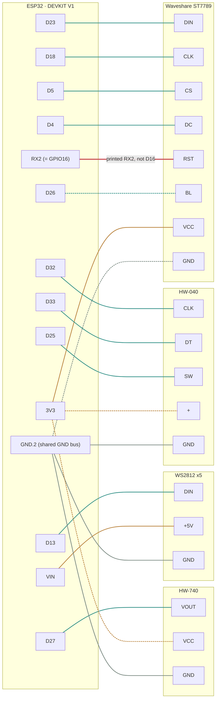

# Desk Dashboard — ESP32 client

## Role in the system
This is the "client" in a server/client relationship with a homelab-side
adapter microservice (separate repo). The ESP32 is intentionally dumb — it
subscribes to MQTT, parses whatever JSON the server publishes, and renders
it. No business logic (severity decisions, adapter polling) belongs here.

## Hardware
- MCU: ESP32-WROOM-32 dev board (ELEGOO), USB-C
- Display: Waveshare 2" IPS LCD, ST7789VW driver, 240x320, SPI (use
  TFT_eSPI library; needs a `User_Setup.h` matching actual wiring pins).
  Native orientation is portrait 240x320 — rotate to landscape 320x240 in
  software via TFT_eSPI's rotation setting.
- Input: HW-040 rotary encoder module (silkscreened HW-040, not KY-040 —
  same pinout: `CLK`, `DT`, `SW`, `+`, `GND`) — rotation for navigation,
  integrated push button for select/menu-open. Board has no visible
  pull-up resistors, so firmware always sets `INPUT_PULLUP` on all three
  signal pins — safe even if pull-ups turn out to be present too.
- Status LEDs: 5x WS2812 (NeoPixel) addressable strip, 5050 flexible strip
  with each pixel's pads labeled `+5V`/`DIN`(or `DO`)/`GND` and an arrow
  showing data direction into `DIN`. Use FastLED or Adafruit_NeoPixel.
  Wire the ESP32 to the end labeled `DIN`. Add a series resistor (~300-500
  ohm) on the data line and a decoupling cap (~100-1000uF) across 5V/GND,
  both at that `DIN` input end. Data line is 3.3V (ESP32 GPIO) driving
  5V-logic pixels — works fine at this scale over short wire runs; revisit
  with a level shifter (74AHCT125) only if signal issues appear.
- Presence: HW-740 mini PIR motion sensor module (`VCC`/`VOUT`/`GND`) —
  drives backlight on/off based on whether anyone's at the desk. Powered
  from 3.3V, not 5V/6V (within its spec range but the safer choice): the
  digital output swings up to VCC, and running it at 3.3V keeps that
  signal within the ESP32 GPIO's safe voltage range instead of risking a
  5V signal into a 3.3V-only input.
- Power: External 5V/2A DC supply (USB-C wall adapter) — no battery/UPS.
  Desk-bound and always-on, so battery backup isn't solving a real problem
  here; deferred to a future project instead. 2A over 1A for headroom: WS2812
  strip at full white (~300mA) plus a WiFi TX burst (~500mA momentary) plus
  display/backlight leaves a 1A supply almost no margin, risking brownout
  resets. Bring 5V/GND from the adapter to a shared point and branch to (a)
  the ESP32's `5V`/`VIN` pin (or USB-C port) and (b) the LED strip's 5V/GND
  input directly — don't route strip current through the ESP32's onboard
  3.3V regulator.

  Powering the board via its USB-C port instead of wiring 5V into `VIN`
  directly doesn't change any of this: `VIN` and USB-C's 5V input are the
  same net on this board (confirmed against ESP32 DevKit V1 hardware
  references, not assumed) — plugging in USB-C energizes `VIN` too, so
  branching the LED strip's power off the board's own `VIN`/`GND` pins
  works exactly as already wired. Only watch for it if the board resets
  specifically when the LEDs go bright — that would mean the strip's
  ~300mA is more than the board's internal USB-5V-to-`VIN` trace likes,
  and the fix is running the strip's `+5V`/`GND` straight to the adapter
  instead of through the board.

## Pin assignments
Verified against the actual ELEGOO ESP32-WROOM-32 board (38-pin
"DEVKIT V1" layout), the Waveshare display module, the HW-040 encoder, and
the WS2812 strip in hand — not just datasheets. Board is WROOM (no PSRAM),
so GPIO16/17 are free to use as plain GPIO.

See [`docs/pinout.html`](docs/pinout.html) for a visual wiring diagram —
open it in a browser (it's self-contained, no server needed). Same data
as the table below, laid out for the workbench: shows the two GPIO16 and
PIR pinout gotchas directly on the wires that matter, and draws the 3V3
power-bus crossing explained in the Power note above.

A lighter version of the same wiring, for whenever opening that HTML
file isn't convenient — this one renders directly on GitHub:



Both power and ground are physical bus strips in the real build, not
point-to-point wiring — see the "bus strips" note below. Dashed
edges are every wire that has to cross to reach one: backlight to the
left column, 3V3 fanning out to the right, and the display's ground
crossing left too (GND is sourced from `GND.2`, not `GND.1`, since
three of the four things needing it already sit on that side). The red
edge is the RX2 gotcha. Same underlying data as the table below and
`docs/pinout.html` — if these three ever disagree, the table is the
source of truth to reconcile the other two against.

| Function | Signal | GPIO | MCU board silkscreen |
|---|---|---|---|
| Display | MOSI/`DIN` | 23 | `D23` |
| Display | SCLK/`CLK` | 18 | `D18` |
| Display | `CS` | 5 | `D5` |
| Display | `DC` | 4 | `D4` |
| Display | `RST` | 16 | **`RX2`** — not `D16`, see note |
| Display | `BL` | 26 | `D26` — digital on/off, not PWM (see note) |
| Display | `VCC`/`GND` | — | 3.3V / GND |
| Encoder | `CLK` | 32 | `D32` |
| Encoder | `DT` | 33 | `D33` |
| Encoder | `SW` | 25 | `D25` |
| Encoder | `+`/`GND` | — | 3.3V / GND |
| LED strip | `DIN` | 13 | `D13` |
| LED strip | `+5V`/`GND` | — | from the external 5V supply, not the ESP32 |
| PIR | `VOUT` | 27 | `D27` |
| PIR | `VCC`/`GND` | — | 3.3V / GND (3.3V, not 5V — see Hardware note) |

Notes:
- **GPIO16/17 silkscreen gotcha:** this specific board prints its alternate
  UART2 function (`RX2`/`TX2`) on GPIO16/17 instead of `D16`/`D17`. Display
  `RST` is wired to `RX2`. Don't go looking for a pin labeled `D16` — it
  isn't there under that name.
- Display board has no `MISO`/`SDO` pin at all (write-only) — leave
  `TFT_MISO` undefined in `User_Setup.h` rather than pointing it at an
  unused GPIO.
- `BL` is digital on/off (`digitalWrite`), not PWM dimming — the PIR-driven
  backlight behavior (see Firmware architecture) only needs two states,
  so there's no need for LEDC/PWM complexity here.
- **Both 3V3 and GND are physical bus strips, not point-to-point wiring:**
  a row of header pins with their legs bridged by a soldered wire across
  the back, one feed-in and several feed-out per strip. 3V3 has no
  choice (it's the only 3.3V pin on the board), but GND is a deliberate
  choice too — sourced from `GND.2` specifically (not `GND.1`) since
  three of the four things needing ground (encoder, PIR, LED strip)
  already sit on that side, so only the display's ground needs to cross,
  rather than adding more crossings. `GND.1` is unused as a result —
  it's a hardwired ground pin on the board, not a GPIO, so it doesn't
  belong in the "free for later" list below the way an unused GPIO would.
- Not used, confirmed present and free for later: `D14`, `D19`, `D21`,
  `D22` (the latter two freed up when the UPS/I2C module was dropped;
  `D26`/`D27` are now taken by backlight control and the PIR).
- Still avoid: `GPIO0`/`2`/`12`/`15` (boot straps), `GPIO1`/`3` (UART0 —
  flashing/Serial), `GPIO6`-`11` (internal flash), `GPIO34`-`39`
  (input-only, no internal pull-up — ruled out the encoder pins for that
  reason, since the HW-040 board supplies none of its own).

## Firmware architecture
### Connectivity
- WiFi connect with reconnect logic (don't assume it stays up)
- MQTT client (PubSubClient or ArduinoMqttClient) subscribing to:
  - `homelab/status` — full status payload; update relevant UI on receipt
  - `homelab/alert/camera` — jump to camera pop-up view on receipt
- MQTT reconnect logic is a real piece of work here, not an afterthought —
  handle broker disconnects gracefully, don't just hang

### Screen state machine
Three states, not more:
1. **HOME** (default) — top banner (~30px) shows alert status
   (green/amber/red + short text); body auto-rotates through status cards
   every 4-5s; bottom shows position dots. Manual encoder rotation pauses
   auto-rotate for ~10s then resumes.
2. **MENU** — opened by encoder button press from HOME. Full-screen
   overlay, vertical list, 6 visible rows (grew from an original 5 when
   Configs was added — see Backlight/presence below), current selection
   highlighted (inverted color). Items: Pin a screen, Mute alerts,
   Refresh now, Network info, Configs, Back. 15-20s idle timeout returns
   to HOME.
3. **CAMERA** — auto-triggered by an incoming `homelab/alert/camera`
   message (not reachable from the MENU item list above, and nothing in
   that list is camera-related). Suppressed entirely while muted, same
   "don't surprise-interrupt" principle as the backlight. Decodes a JPEG
   snapshot (TJpg_Decoder) proxied from the server — NOT live video,
   ESP32 cannot decode RTSP/H.264. This is a distinct screen state, not
   blended into HOME's auto-rotation, since JPEG decode + SPI blit is
   slow enough to disrupt the main loop if run continuously. Exits back
   to HOME on either an encoder button press or the same shared idle
   timeout as MENU — this needed its own exit condition, since there was
   otherwise no way to leave it once an alert had no viewer around to
   dismiss it.

### Backlight / presence
Independent of screen state — runs the same in HOME, MENU, and CAMERA.
PIR `VOUT` HIGH turns the backlight (`BL` GPIO) on immediately, and so
does any encoder input (rotation or a press) — whichever happened more
recently is what keeps it lit. That second trigger was added after
real-world use turned up a real gap: PIR-only meant actively using the
menu with a hand on the encoder, but not otherwise moving enough to
retrigger the PIR, could dim the screen out from under you mid-
interaction. On no activity from either source for the timeout window,
it switches off. No PWM/dimming — just on/off, since that's all this
needs. Doesn't touch screen state at all: CAMERA and MENU behave exactly
as already designed regardless of presence; this only ever changes
whether the backlight is lit.

The timeout itself is no longer DESIGN.md's shared `kIdleTimeoutMs`
(still used by MENU/CAMERA) — it split into its own value in
`backlight.cpp`, runtime-adjustable via the MENU's **Configs** item
(rotate to change in 5s steps, clamped 5-120s, press to save). Like
mute/pin, this does *not* persist across a reboot — it resets to its
compiled-in default (18s) every boot, same "fail toward showing, not a
surprising leftover setting" reasoning.

### Non-blocking is mandatory
No `delay()` calls anywhere in the main loop — use `millis()`-based timers
for card rotation, menu timeout, etc. Blocking delay breaks encoder
responsiveness and MQTT message handling.

### Pixel mapping
The server sends a pixel-index -> color mapping as the `pixels` object in
`homelab/status` — e.g. `{"0": "#1D9E75", "1": "#BA7517", ...}`, keys `"0"`
through `"4"`, value `null` for an unassigned pixel. The firmware just sets
those pixel colors directly (or turns the pixel off on `null`); it does not
decide which service maps to which pixel or which color a status implies —
that's all server-side (see `pixel_map` config in the server repo).

## MQTT JSON payload schema
Locked against the server repo (`desk-dashboard-server/DESIGN.md`) — both
docs carry this section verbatim; update them together if it changes.

### `homelab/status`
Published on any adapter state change and as a ~30-60s heartbeat regardless.
```json
{
  "version": 1,
  "ts": 1737000000,
  "overall": {
    "level": "ok",
    "text": "All systems normal"
  },
  "services": [
    {
      "name": "plex",
      "status": "ok",
      "value": 4,
      "unit": "streams",
      "detail": "4 active streams"
    }
  ],
  "pixels": {
    "0": "#1D9E75",
    "1": "#BA7517",
    "2": "#1D9E75",
    "3": "#1D9E75",
    "4": null
  }
}
```
- `overall.level` is `"ok"` | `"warn"` | `"down"` — drives the HOME banner
  color directly; the client does not derive it from `services`.
- `overall.text` is the short banner string, already worded server-side.
- `services` is an array, in server-decided order — that order is the HOME
  card rotation order. Each entry matches the adapter's `fetch()` shape
  (`status`/`value`/`unit`/`detail`) from the server repo.
- `pixels` keys are always strings `"0"`-`"4"` (JSON object keys can't be
  bare ints); `null` means "off/unassigned", not "no change".
- `ts` is unix seconds. Not currently used by the firmware but parse it
  anyway — useful for staleness checks later (e.g. banner goes gray if no
  message for N minutes).

### `homelab/alert/camera`
```json
{
  "camera": "front_door",
  "ts": 1737000000,
  "snapshot_url": "http://<host>/api/frigate/front_door/latest.jpg",
  "label": "person",
  "text": "Front Door: person detected"
}
```
- `snapshot_url` is fetched by the ESP32 over plain HTTP GET (not embedded
  in the MQTT payload — keeps the message small and avoids broker
  max-packet-size issues). Server has already resized the JPEG to the
  display's resolution.
- `label` is the detected object class, optional — omit or `null` if not
  applicable.
- `text` is the pre-worded string for the CAMERA screen's caption.

### Firmware implication
Default `PubSubClient` payload buffer is 256 bytes — too small once
`services` has more than 1-2 entries. Call
`mqttClient.setBufferSize(...)` sized to the largest expected
`homelab/status` payload, with headroom for adapter count growing past
the initial 2-3. Done in [`src/main.cpp`](src/main.cpp) — currently 2048
bytes, revisit if `services` grows enough to need more.

## Project layout
PlatformIO project (`platformio.ini`). `src/main.cpp` wires together one
small module per concern: `status_payload` (JSON parsing), `encoder`,
`leds`, `backlight`, `screen` (the HOME/MENU/CAMERA state machine), `ota`.
Real credentials go in `include/secrets.h` (gitignored; copy
`include/secrets.h.example` and fill it in) — never commit that file.

## OTA firmware updates
`ota.cpp` runs ArduinoOTA (built into the ESP32 Arduino core, no extra
library) once WiFi is connected — independent of MQTT, so a broken
broker/server never blocks the one way to fix broken firmware. Once it's
running, no USB/physical access is needed to flash new firmware again:

```
OTA_PASSWORD=<same value as secrets.h's OTA_PASSWORD> pio run -t upload -e esp32dev-ota
```

`upload_port` in `platformio.ini` defaults to the board's mDNS hostname
(`desk-dashboard-esp32.local`); if `.local` resolution doesn't work on
your network/OS, override it with the device's actual IP instead:
`pio run -t upload -e esp32dev-ota --upload-port <ip>` (read off Serial —
`ensureWifi()` prints it once on connect).

`OTA_PASSWORD` has to exist in two places, for two different reasons: as
a `#define` in `secrets.h` (compiled into the firmware, so it can
authenticate incoming OTA requests) and as a shell env var of the same
name (read by `platformio.ini`'s `upload_flags` at upload time, so the
*tool* doing the flashing can prove it knows the password too). Without
a password at all, anything on the LAN could push firmware to this
board — not something to skip even on a trusted home network.

Verified end-to-end on real hardware: a real OTA upload over WiFi with
no USB cable attached, board rebooted cleanly afterward, resumed normal
operation.

## Reliability: a message-repeat bug, and heap hygiene
Two unrelated bugs, found on real hardware, not in review — both would
have been invisible in a short bench test and both matter specifically
*because* this runs unattended for days at a time.

### Bug 1 — FastLED.show() inside the MQTT callback
Symptom: the exact same `homelab/status` message got redelivered to
`onMqttMessage()` thousands of times a second, indefinitely, instead of
once every 15-60s like the broker actually sends it.

Cause: `ledsUpdate()` (i.e. `FastLED.show()`, which briefly disables
interrupts for WS2812's precise bit timing) was running synchronously
inside the callback. That delayed the TCP ACK for the packet just
received long enough that the broker's stack retransmitted it; our stack
delivered the retransmission as a "new" MQTT message, which called
`ledsUpdate()` again, delaying the ACK again — self-sustaining.

Fix: moved `ledsUpdate()` out of the callback and into `loop()`, gated
by the same one-shot "a new message actually arrived" flag already
driving the screen. The callback now only ever parses and sets a flag —
no SPI, no FastLED, nothing that can block returning to the network
stack.

One methodology trap worth recording: after applying this fix, the same
symptom appeared to persist across several follow-up tests. It hadn't —
each of those tests was reading a mix of genuinely fresh serial output
plus *stale backlog from an older, already-stuck boot* still sitting in
the OS's kernel serial buffer. A clean single-reset capture, read from
that exact reset forward, was what actually confirmed the fix. Multiple
`pio device monitor`/pyserial sessions opened back-to-back without an
explicit fresh reset will misattribute old output to new firmware.

### Bug 2 — heap fragmentation from per-message String/JsonDocument churn
This one doesn't show up as a dramatic failure — it's a slow-onset risk
that a short test can't rule out, only a long one can.

Every incoming message (every 15-60s, forever, for as long as this
board is plugged in) used to: construct a fresh `JsonDocument` and
destroy it, and reassign ~26 `String` fields across
`StatusPayload`/`ServiceReading`. Both are real heap allocate/free
cycles. Individually harmless; over thousands of cycles across days of
uptime, this is exactly the kind of workload that fragments an embedded
heap (many small allocations of varying size, `String` in particular
has no reuse-in-place guarantee on reassignment).

Fix:
- `status_payload`'s `String` fields became fixed `char[]` buffers
  (silently truncated if ever too long, never a crash) — zero heap
  involvement.
- The `JsonDocument` in each parse function became a function-`static`,
  reused via `.clear()` rather than constructed fresh per call.
  Confirmed against ArduinoJson's own source (not assumed) that
  `clear()` resets the memory pool without necessarily freeing the
  backing allocation.
- The MQTT topic comparison in `main.cpp` became `strcmp`, not a
  temporary `String` — same reasoning, still per-message.
- `screen.cpp`'s `colorForLevel()` and the muted-banner text also
  stopped going through `String`, since they're on the HOME redraw path
  (frequent, if not per-message).

**Verification methodology** (this is the part a clean compile can't
give you): added temporary heap diagnostics to `main.cpp` — logged every
30s via `ESP.getFreeHeap()`, `ESP.getMinFreeHeap()`, and specifically
`ESP.getMaxAllocHeap()` (the largest *contiguous* allocatable block —
the fragmentation-sensitive number; total free heap can look fine while
this one shrinks). Watched both figures on the pre-fix firmware as a
baseline, then on the fixed firmware, deployed via OTA specifically so
the comparison didn't require another USB session.

As of this writing: pre-fix baseline held flat for 5 minutes before
switching over (not long enough to have caught the original problem
either — it's what gave the false "fixed" impression the first time).
Post-fix, `free`/`maxAlloc` held completely flat through at least the
~15 minute mark, past the point where the original symptom first
appeared. Longer soak testing (hours, ideally a full day) is the only
way to be fully confident this is resolved rather than just slower to
surface — treat that as still open.

**Cleanup note:** the heap diagnostic block in `main.cpp` (marked
`TEMPORARY` in its comment) should come out once this is confidently
resolved — it's a real, if small, ongoing Serial-print cost that has no
reason to ship permanently.

## Testing before hardware arrives
Use **Wokwi** (wokwi.com, also a VS Code extension) — simulated ESP32 +
rotary encoder + WS2812 strip + PIR, wired per [`diagram.json`](diagram.json).
`wokwi.toml` points it at the PlatformIO build output, so the VS Code
extension's simulate command builds and runs it directly. Its simulated
ESP32 only joins the "Wokwi-GUEST" open network (see
`secrets.h.example`'s note) but that network does reach the public
internet.

**Display correction:** Wokwi has no native ST7789 simulation part (as of
this writing it's still an open feature request, not a built-in). Per
Wokwi's own maintainer, the standard stand-in is the `ili9341` part —
ST7789 and ILI9341 share a largely compatible command set, so it's good
enough for exercising firmware logic (layout, redraw timing, SPI wiring)
even though it isn't pixel-perfect to the real panel. `diagram.json` wires
an `ili9341` part using the confirmed pin table above; its `MISO` pin is
left unconnected to match the real display (which has no `MISO`/`SDO`
broken out), and its `RST` lands on `esp:RX2` (GPIO16), same gotcha as the
real board.

To test against the real homelab Mosquitto broker (LAN-only, not public),
use **wokwigw** (Wokwi's IoT Gateway — the tool previously referred to
here as "wokwi-server", corrected name), which bridges the simulated
device's network calls to the real local network via `host.wokwi.internal`.
**Requires a paid Wokwi Hobby+/Pro plan**, not just a free account — worth
confirming before relying on it. Without it, the free tier still connects
the simulated ESP32 to the public internet (via the "Wokwi-GUEST" network),
just not to the LAN-only broker.

## Open items for Claude Code to help resolve
- ~~Confirm the `/status` (or MQTT payload) JSON schema against the server
  repo before writing the parser~~ — done, see "MQTT JSON payload schema"
  above (locked with the server repo)
- ~~Decide exact SPI pin assignments once wiring is finalized, write
  TFT_eSPI's User_Setup.h accordingly~~ — done, verified against real
  hardware (see "Pin assignments" above) and drafted in
  [`include/User_Setup.h`](include/User_Setup.h)
- ~~Write the Wokwi diagram.json for local simulation~~ — done, see
  [`diagram.json`](diagram.json) (uses `ili9341` as an ST7789 stand-in,
  see "Testing before hardware arrives" above for why)
- ~~Decide whether "Mute alerts" and "Pin a screen" states need to persist
  across a reboot~~ — done: neither persists. Both reset to default
  (unmuted, auto-rotate) on every boot, from plain `setup()`
  initialization — no NVS/Preferences writes needed. Reboots on this
  device (power blip, reflash, watchdog reset) are usually unattended, and
  a muted display that silently stays muted after an unattended reboot is
  the worst failure mode for a status board — fail toward showing alerts,
  not suppressing them. A pinned screen has no safety angle either way,
  but resetting it too keeps the behavior consistent and the
  implementation with zero persistence code.
- Confirm the heap fragmentation fix (see "Reliability" above) with a
  proper long soak — hours, ideally a full day — then remove the
  `TEMPORARY` heap diagnostic block from `main.cpp` once confident.
