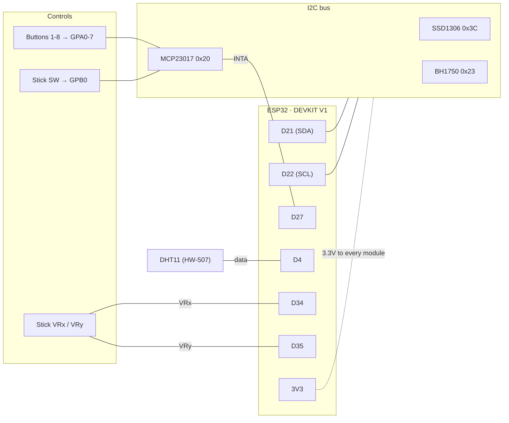

# Bedside Dashboard — ESP32 client

A bedside sibling of [desk-dashboard-esp32](https://github.com/traviswolverton/desk-dashboard-esp32),
forked from it with full history. Connectivity, OTA and the NVS settings
pattern carry over; the display, controls and sensors are all new. For the
reasoning behind the inherited pieces (non-blocking MQTT, heap-churn-free
payload parsing, OTA partition layout), see the desk repo's `DESIGN.md` at
the fork point — `git log` here reaches it too.

## Role in the system
Same split as the desk unit: the ESP32 is the dumb end. It shows what
`bedside-dashboard-server` sends, reports its sensors, and publishes raw
button presses. What a button *does*, and every threshold worth tuning,
lives on the server.

## Hardware
- **MCU:** ELEGOO ESP32-WROOM-32 (38-pin DEVKIT V1), same board as the desk unit.
- **Display:** 0.91" SSD1306 OLED, 128×32, monochrome, I2C (0x3C). Not
  AMOLED, despite the listings — a small passive OLED. Draws nothing on
  black pixels, can be powered off by command, and has a contrast register.
- **Buttons:** 8 momentary push buttons on a Waveshare MCP23017 I/O
  expander (I2C, 0x20), GPA0–GPA7, each switching to GND. The expander's
  internal pull-ups are enabled; no resistors needed.
- **Joystick:** KY-023 (two potentiometers + a push switch). Axes on
  ESP32 ADC1; the switch on the expander's GPB0.
- **Light:** BH1750 on a GY-302 board (I2C, 0x23 with ADDR low/floating).
- **Temperature/humidity:** DHT11 on an HW-507 board (single-wire, own GPIO;
  the board carries the data pull-up).
- **Power:** 5V USB into the ESP32. Everything else runs from its 3.3V pin.

**Everything is 3.3V.** Two boards invite 5V — the KY-023's pin is
literally labelled `5V`, and the HW-507 accepts 3.3–5V. Don't: the joystick
outputs a fraction of its supply, so at 5V it would put up to 5V into an
ESP32 pin rated for 3.3V; the DHT11's data line likewise swings to its
supply.

## Pin assignments

| Function | Signal | GPIO | Board silkscreen |
|---|---|---|---|
| I2C bus (OLED, BH1750, MCP23017) | SDA | 21 | `D21` |
| I2C bus | SCL | 22 | `D22` |
| MCP23017 | `INTA` | 27 | `D27` |
| DHT11 | data (`S`/`DAT`) | 4 | `D4` |
| Joystick | `VRx` | 34 | `D34` |
| Joystick | `VRy` | 35 | `D35` |
| MCP23017 | GPA0–GPA7 | — | buttons 1–8, other leg to GND |
| MCP23017 | GPB0 | — | joystick `SW`, other side is its `GND` |
| MCP23017 | A0–A2 | — | leave at default (address 0x20) |
| All modules | VCC / GND | — | `3V3` / `GND` |

`include/pins.h` holds the same assignments in code. If the two ever
disagree, this table is what the hardware was built from.

Why these pins:
- **21/22** are the ESP32's default I2C pins. The three I2C devices have
  distinct fixed addresses, so one bus serves them all.
- **34/35 for the joystick:** analog reads must use ADC1 (GPIO32–39) —
  ADC2 stops working whenever WiFi is on. 34/35 are input-only, which is
  all an analog read needs. They have no internal pulls, so an *unplugged*
  joystick floats; the firmware checks the boot-time centre reading and
  disables the stick if it's pinned near a rail, but a floating pin can
  land anywhere, so treat odd drift with nothing connected as expected.
- **27 for `INTA`:** the expander drives it open-drain and active-low
  (configured that way on purpose, so the ESP32's pull-up sets the idle
  level). Both expander ports are mirrored onto `INTA`, so `INTB` is unused.
- Still avoid: GPIO0/2/12/15 (boot straps), 1/3 (serial), 6–11 (flash).
- Free for later: 13, 14, 16–19, 23, 25, 26, 32, 33.

**Mounting the light sensor:** at night the interesting light levels are
0–5 lux, and a lit OLED a few centimetres away is enough to move that. Put
the BH1750 where it sees the room, not the screen — facing up or out,
behind the panel's edge, never looking at the display. The firmware guards
against the obvious feedback loop (see Dimming) but can't undo a sensor
that mostly measures the screen.

## Firmware layout

| File | What it owns |
|---|---|
| `main.cpp` | Glue: WiFi/MQTT, topics, publishing, the loop |
| `display.*` | The SSD1306: U8g2 full-frame buffer, levels, burn-in drift |
| `dimmer.*` | Lux → Off / Dim / Full, and wake-on-touch |
| `input.*` | Buttons, joystick press and axes → debounced events |
| `sensors.*` | BH1750 (smoothed) and DHT11 readings |
| `screen.*` | What's drawn — currently the bench bring-up view |
| `settings_store.*` | Dimmer settings in NVS, surviving reboots |
| `status_payload.*` | Parses the server's status (inherited; reshaped for the small screen next) |
| `ota.*` | ArduinoOTA, hostname `bedside-dashboard-esp32` |

Every module is non-blocking and polled from `loop()`, as on the desk
unit. The one deliberate exception is the DHT11 read (a few milliseconds
with interrupts held off, once every 10s).

A missing I2C device never stops the firmware: each module checks for its
chip at boot, logs what it didn't find, and the bench screen names it on
its bottom line (`No BH1750 MCP stick`). Serial also prints a full I2C
scan at boot.

## Dimming

Three levels, chosen from smoothed room light (lux):

| Room | Screen |
|---|---|
| `lux ≥ bright_lux` (default 20) | Full |
| `dark_lux ≤ lux < bright_lux` | Dim |
| `lux < dark_lux` (default 2) | Off — a touch wakes it at Dim for `wake_seconds` (default 15) |

- **Smoothing:** readings every 250ms, averaged over ~2s, so headlights
  across the ceiling don't flick the screen. A drop to real darkness is
  taken immediately rather than eased toward.
- **Hysteresis:** each threshold must be crossed by 20% (at least 0.5 lx)
  before the level changes.
- **The wake press does nothing else.** The touch that wakes a dark
  screen is swallowed — a button's press, the stick's movement until it
  returns to centre, the stick's click — so reaching over in the dark to
  see the time can't also toggle a light. Touches while already awake
  restart the timer and act normally.
- **The screen can't keep itself awake.** While woken in the dark, only
  a real light (past `bright_lux`) ends dark mode early; the screen's own
  glow on the sensor can't nudge the room into Dim and hold the screen on.
- **Dim is dimmer than contrast alone.** Contrast 0 on an SSD1306 is
  still bright in a dark room, so Dim also lowers the panel's pre-charge
  and VCOMH voltages (`display.cpp`). If a particular panel misbehaves at
  those values (flicker, uneven rows), that's the place to tune.
- **No sensor, no reading:** Full. Fail toward a readable screen.
- **Burn-in:** the whole frame drifts by one pixel every 3 minutes around
  a small square, so nothing sits on the same pixels all night.

Settings come from the server (`bedside/config`, below) and are saved to
NVS, so a power cut at 3am brings the screen back with the right
thresholds before WiFi is up.

## Controls

- **Buttons 1–8:** 25ms debounce. A press released before 600ms is
  `short`; held to 600ms fires `long` once (and nothing on release).
  Published as raw presses — what each does is configured on the server.
- **Joystick:** centre calibrated at boot (so don't hold it while
  powering on). Enters a direction past ~40% deflection, leaves below
  ~25%. Holding repeats after 450ms, then every 150ms. Its press is a
  plain event. The stick is for on-device navigation and isn't published.
  If it reads rotated once mounted, flip `kSwapAxes` / `kInvertX` /
  `kInvertY` in `input.cpp`.

## MQTT

Client ID `bedside-dashboard-esp32`, the bedside stack's own broker on
port 1884.

| Topic | Direction | Retained | Payload |
|---|---|---|---|
| `bedside/status` | server → device | yes | status payload (small-screen format: next step) |
| `bedside/config` | server → device | yes | `{"dimmer":{"bright_lux":20,"dark_lux":2,"dim_contrast":1,"wake_seconds":15}}` — any field optional |
| `bedside/sensors` | device → server | yes | `{"temperature_c":21.5,"humidity":44,"lux":3.5,"screen":"off"}` — `null` for a sensor with no reading |
| `bedside/button` | device → server | no | `{"button":3,"press":"short"}` or `"long"` |
| `bedside/availability` | device → server | yes | `online`, or `offline` (the connection's last will) |

`bedside/sensors` goes out every 30s, on every (re)connect, and whenever
the screen level changes. Presses aren't retained or queued while offline:
replaying one later would trigger whatever it's bound to after the fact.

Config values are clamped on arrival (`dark_lux` ≤ `bright_lux`, contrast
0–255, wake 3–600s), so a bad server value can't produce a screen that
never turns on.

## Bench bring-up

1. `cp include/secrets.h.example include/secrets.h` and fill it in.
2. `pio run -t upload` over USB (first flash must be USB — see the
   partition note in `platformio.ini`), then `pio device monitor`.
3. The serial log's `[i2c] found:` line should list `0x20 0x23 0x3C`.
4. The screen's top line shows temperature, humidity and lux, with `W`
   and `M` at the right once WiFi and MQTT are up. The bottom line names
   any missing hardware, and shows each button or stick movement for 3s.
5. Cover the light sensor: the screen dims, then turns off. Press a button:
   it comes back at Dim, and that press isn't published.

## Still to build
- **Small-card status format** — the server's cards are laid out for the
  desk's 320×240 color LCD. The bedside needs its own payload shape for 3
  lines of 21 characters (or one large line), and the screen to render it
  with joystick navigation.
- **A clock** — NTP time is the obvious resting screen at night.
- **Server side** — the bedside server stack (port 8001, broker 1884),
  button bindings, the dimmer settings UI, and Home Assistant MQTT
  discovery for the three sensors.
