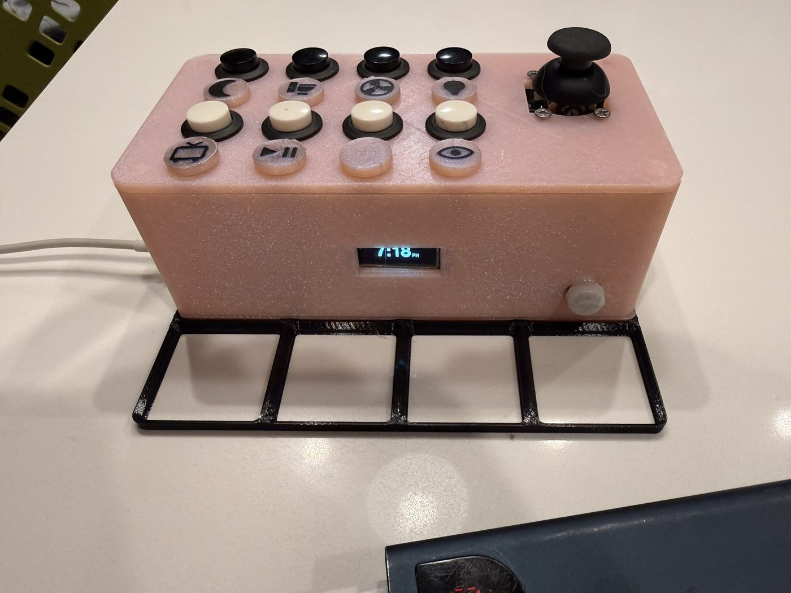
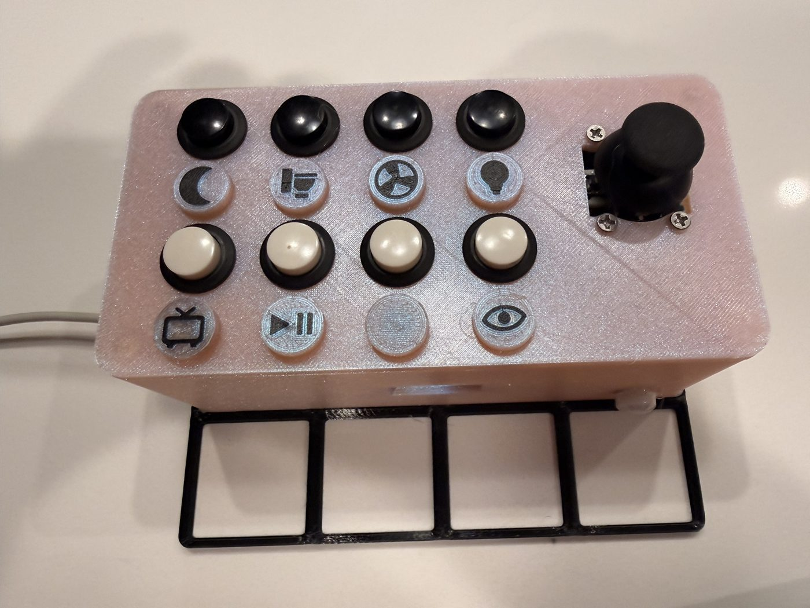
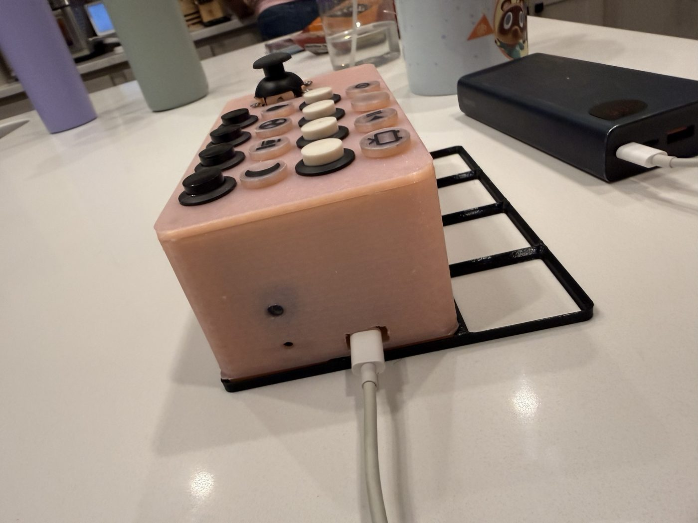

# Goodnight device (ESP32)

A bedside clock and control panel built on an ESP32. A small OLED shows the
time and the room's temperature, humidity and light; eight buttons and a
joystick send their presses out for home automation to act on; a light sensor
dims the screen to match the room, down to off in the dark.

The ESP32 is the dumb end of a pair: it shows what a server tells it and
reports its sensors and raw button presses over MQTT. What each button *does*
lives on the server ([goodnight-server](https://github.com/traviswolverton/goodnight-server), a separate project), so
changing a binding never needs a reflash. It was forked from an earlier
desk-dashboard ESP32 project and keeps its connectivity, OTA and settings code.



| | |
|---|---|
|  |  |

## Hardware

- ELEGOO ESP32-WROOM-32 (30-pin DEVKIT V1)
- 0.91" SSD1306 OLED, 128×32, I2C
- MCP23017 I/O expander (Waveshare board) carrying 8 push buttons
- KY-023 joystick
- BH1750 light sensor, DHT11 temperature/humidity sensor
- AM312 mini PIR motion sensor
- Passive buzzer module (I/O, VCC, GND)
- A 24 × 55 mm stripboard with screw terminals for the four shared buses
  (GND, 3V3, SDA, SCL); everything else is a Dupont jumper
- A printed 4 × 2 Gridfinity-base case with magnets; its parts list is in
  [docs/enclosure.md](docs/enclosure.md#parts-list)

Everything runs from the ESP32's 3.3V pin. Pins, wiring and the reasons for
them are in [DESIGN.md](DESIGN.md); [docs/pinout.html](docs/pinout.html) is a
wiring diagram you can open in a browser.

## Build and flash

Needs [PlatformIO](https://platformio.org/).

```sh
cp include/secrets.h.example include/secrets.h   # then fill it in
pio run -t upload                                # the first flash must be over USB
pio device monitor
```

Instead of filling `secrets.h` in by hand, it can be generated from an
[OpenBao](https://openbao.org/) KV v2 store. Set `BAO_ADDR` and one way to
authenticate: a `BAO_TOKEN` (for example from `bao login`), or an AppRole
with `BAO_ROLE_ID` and `BAO_SECRET_ID` (each also as a `_FILE` path, so the
secret-id needn't be in the environment; the token it earns is revoked when
the run ends). `BAO_CACERT` or `BAO_SKIP_VERIFY=1` handle a self-signed
certificate:

```sh
scripts/gen_secrets.py --check    # fetch and compare define names with the current file, write nothing
scripts/gen_secrets.py            # write include/secrets.h (the old one is kept as secrets.h.old)
```

It reads `bedside/secrets` (`ota_password`, `device_token`, `mqtt_password`, `wifi_ssid`, `wifi_password`)
and `bedside/config` (`server_url`, `mqtt_host`, `mqtt_port`, optionally
`mqtt_username`) under the `homelab/` mount (`BAO_MOUNT`, `BAO_PATH` to change
that). It never prints a value. `wifi_ssid` and `wifi_password` in `bedside/secrets`
are required: the device takes its WiFi network only from `secrets.h`.
`scripts/gen_secrets.py --lint` checks `secrets.h.example` against what the
script produces, with no network.

After that, updates can go over the air:

```sh
OTA_PASSWORD="$(scripts/gen_secrets.py --ota-password)" pio run -t upload -e esp32dev-ota
```

(or `OTA_PASSWORD=<the value in secrets.h>` if `secrets.h` is hand-made).

`secrets.h` is gitignored.

## Documentation

| | |
|---|---|
| [DESIGN.md](DESIGN.md) | Hardware, pin table, firmware layout, dimming, controls, MQTT topics |
| [docs/pinout.html](docs/pinout.html) | Wiring diagram |
| [docs/button-actions-spec.md](docs/button-actions-spec.md) | What each button should do, for the Home Assistant side |
| [docs/diagnostics-server-brief.md](docs/diagnostics-server-brief.md) | The device's diagnostics feed, for a server page |
| [docs/idle-off-server-brief.md](docs/idle-off-server-brief.md) | The idle screen-off setting (`idle_off_minutes`), for the server's device config |
| [docs/wiring-checklist.md](docs/wiring-checklist.md) | Which wire goes where, device pin orders, and a test routine for before first power-up |
| [docs/enclosure.md](docs/enclosure.md) | The case: what's inside, parts list, printing, assembly and the button labels |
| [docs/troubleshooting.md](docs/troubleshooting.md) | I2C error floods, phantom stick presses, a stick or sensor that doesn't show up |
| [docs/secrets-rotation.md](docs/secrets-rotation.md) | What each secret is, which need a flash, and the order to rotate them in |
| [todo.md](todo.md) | What's left |
| [enclosure/](enclosure/) | Parametric OpenSCAD enclosure: a 4 x 2 Gridfinity-base tub (167.5 x 83.5 x 63 mm) and lid, the STLs, and the two-colour label plate |

## Enclosure

`enclosure/bedside_enclosure.scad` builds the whole case from the measured
sizes of the parts. Set `part` at the top of the file to one of `tub`, `lid`,
`risers`, `blank`, `blanks`, `label` (a blank with an inlaid icon), a test
piece (`test`, `fit`, `bustest`, `sticktest`), `print` or `assembly`, and
export an STL for each; `assembly` previews everything in place (add
`show_parts = true` to see the boards inside). Values marked `MEASURE` in the
file are guesses to check against your own parts before printing.

What's inside, the parts list, how to print it, how to put it together and how
the two-colour button labels are made are in
[docs/enclosure.md](docs/enclosure.md).

## Status

The firmware and the enclosure are built, and the unit is running in its case
(see [docs/enclosure.md](docs/enclosure.md)). What's left is in
[todo.md](todo.md).

## License

[MIT](LICENSE).
