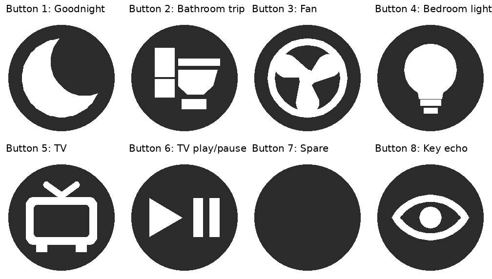

# Enclosure: parts, printing and assembly

The case is one OpenSCAD file, [`enclosure/bedside_enclosure.scad`](../enclosure/bedside_enclosure.scad), built from measured sizes of the parts. It is a rounded box (a tub and a removable lid) with a Gridfinity-compatible base: 4 × 2 cells of 42 mm, each with the standard foot, so it sits in a Gridfinity baseplate or on a desk.

| | |
|---|---|
| Outside size | 167.5 × 83.5 mm (4 × 2 cells less 0.5 mm), 63 mm tall |
| Height | 63 mm is 9 Gridfinity units. The buttons hang 35 mm below the top of the lid, and the tallest thing under them (the bus board's screw terminals) leaves 2.25 mm spare. |
| Wall, lid | 2.4 mm walls, 3 mm lid, 8 mm vertical corner radius |
| Floor | the 4.75 mm Gridfinity foot plus a 2.4 mm floor plate |

The display is on the front (`y = 0`) face. Axes in the file: x runs left to right, y front to back, z up.

## What's inside, and where

Looking at the open tub from above, front at the bottom:

| Part | Where | How it's held |
|---|---|---|
| ESP32 (30-pin) | left-middle, flipped so the pins face up and the USB-C connector points at the left wall | four studs through the board's holes, on posts 4.5 mm up; the USB-C cut-out is in the left wall, 14 mm wide |
| MCP23017 expander | right of the ESP32, turned so its PA header faces the bus board | two studs and corner guards, on posts 3 mm up |
| Bus board (24 × 55 mm stripboard with screw terminals) | right of the expander, long side front to back | one stud through its mounting hole (back left), four corner guards, and hot glue |
| OLED | behind the window in the front wall | |
| PIR (AM312) | front right; the dome pokes through a 12.5 mm hole in the front wall | |
| Buzzer module | left wall, towards the back, in a cradle with a 3.5 mm sound port | |
| BH1750 | left wall, towards the back, above the buzzer, behind a 5 mm window | |
| DHT11 | inside the right wall, behind vent slots, so nothing sticks out | |

The lid carries the eight buttons (two rows of four, each threaded into a 19 mm housing under the lid through a 16.5 mm hole), a label blank in front of each button, and the joystick on the right.

## Parts list

Electronics are listed in the [README](../README.md#hardware). For the case and wiring:

| Item | Qty | Notes |
|---|---|---|
| Stripboard, cut to 24 × 55 mm | 1 | keep its mounting hole |
| Screw-terminal blocks | 8-way ×2, 4-way ×3 | soldered along the copper strips: 3V3 and GND each get an 8-way, GND also a 4-way, SDA and SCL a 4-way each |
| Dupont jumpers | as needed | see the [wiring checklist](wiring-checklist.md) |
| Magnets, 6 × 2 mm | 24 | 4 in the tub's corner bosses and 4 in the lid above them, plus a pair for each of the 8 labels (one in the blank, one in the lid in front of its button). Glue each pair in with the poles opposed so they attract. |
| Super glue | | for the magnets |
| Hot glue | | for the bus board |
| M3 × 8 mm screws and M3 nuts | 4 each | the joystick board's four 3.5 mm holes, with a printed riser on each screw and the nut underneath |
| USB-C cable and a 5 V supply | 1 | the board is powered from USB |
| Black nail polish | | over the ESP32's red power LED, which shows through the filament |

## Printing

Export one STL for each part: set `part` at the top of the scad file (or pass `-D 'part="tub"'` to OpenSCAD). Ready-made STLs for the current design are in [`enclosure/`](../enclosure/).

| `part` | What it is | Print |
|---|---|---|
| `tub` | the tub with the Gridfinity base and corner bosses | feet down |
| `lid` | the lid | right side up. The magnet pockets in its underside need a little support. |
| `risers` | four spacers, 5.5 mm tall, for the joystick's screws | as laid out |
| `label` | one blank with an inlaid icon, see [Button labels](#button-labels) | face down |
| `blanks` | eight plain blanks | face down. Superseded by the labels, but still useful if you want them all plain. |
| `test`, `fit`, `bustest`, `sticktest` | partial pieces to check a fit before printing the whole thing | `fit` holds the three board cages (ESP32, expander, bus board) on one floor, in place |
| `assembly` | the tub and lid in place, for preview. `show_parts = true` adds the boards and the clearance they need. | not for printing |

The file also asserts the tight spots (the ESP32's plug rows against the front button row, the buzzer, light sensor and DHT11 against the corner bosses, the 9-unit height), so a change that breaks one stops the export instead of producing a bad print. Values marked `MEASURE` in the file are guesses to check against your own parts.

## Assembly

1. Test-fit the boards with the `fit` piece first if anything has changed.
2. In the tub: push the ESP32 and the expander onto their studs; fix the bus board on its stud and glue it; put the buzzer in its cradle, the BH1750 behind its window, the DHT11 behind its vent slots, and the PIR through the front wall.
3. Wire it up from the [wiring checklist](wiring-checklist.md), and run its power-up test before plugging in the devices.
4. In the lid: thread the buttons into their housings from underneath, and screw the joystick board down on its four risers, with the M3 × 8 screws from above and the nuts underneath.
5. Glue the magnets into the corner bosses and the lid, then into the label blanks and the lid pockets in front of each button (poles opposed, as above), and press the blanks on.
6. Close the lid. The ESP32's LED can be covered with black nail polish before closing.

## Button labels

Each button has a round label blank in front of it. The blank is a 15.5 mm disc with a magnet pocket behind it, and the icon is inlaid flush in its face, 0.8 mm deep, in a second colour, so the button stays flat.

| Button | Icon | What it does |
|---|---|---|
| 1 | moon | goodnight |
| 2 | toilet | bathroom trip |
| 3 | fan | fan step down |
| 4 | bulb | bedroom light |
| 5 | TV | TV on |
| 6 | play/pause | TV play/pause |
| 7 | plain | spare |
| 8 | eye | the on-screen key echo (device only) |

[`enclosure/bedside_labels.3mf`](../enclosure/bedside_labels.3mf) is ready to print: one plate with all eight, as objects of two parts each (the blank in filament 1, the icon in filament 2), made for Bambu Studio and Orca. Load it, assign your two filaments, and print. The blanks print face down, and the icon is mirrored in the model so that it reads correctly once the blank is turned onto the lid.

To change an icon or add one:

1. Add a case for it in `icon_2d()` in the scad file. Draw it as seen from the front, centred, inside a 12 mm circle.
2. Export the two layers of each icon with OpenSCAD (`part="label"`, `icon="<name>"`, and `layer="base"` or `"icon"`), plus `icon="none"` for the plain blank.
3. Pack them: `python3 enclosure/labels_3mf.py <folder of STLs> enclosure/bedside_labels.3mf`. The exact export commands are in the script's header, and the button-to-icon table is `BUTTONS` at the top of it.
